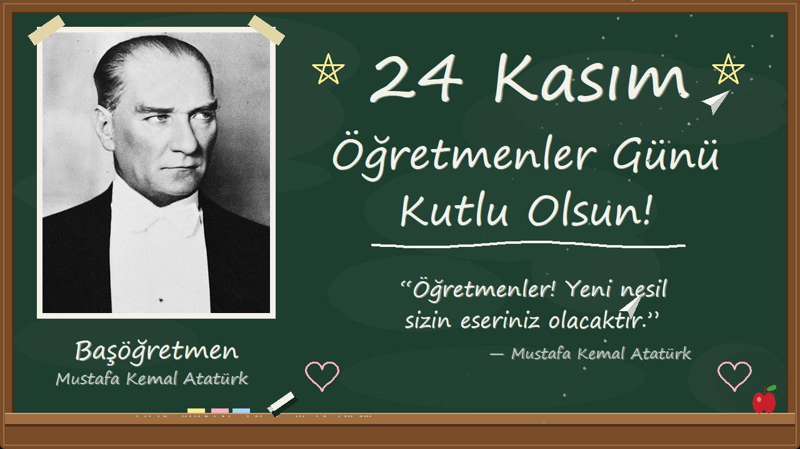
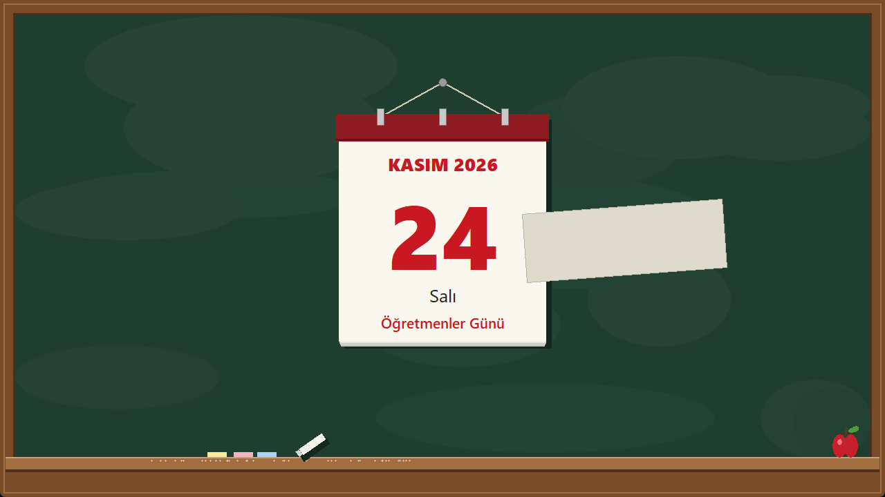
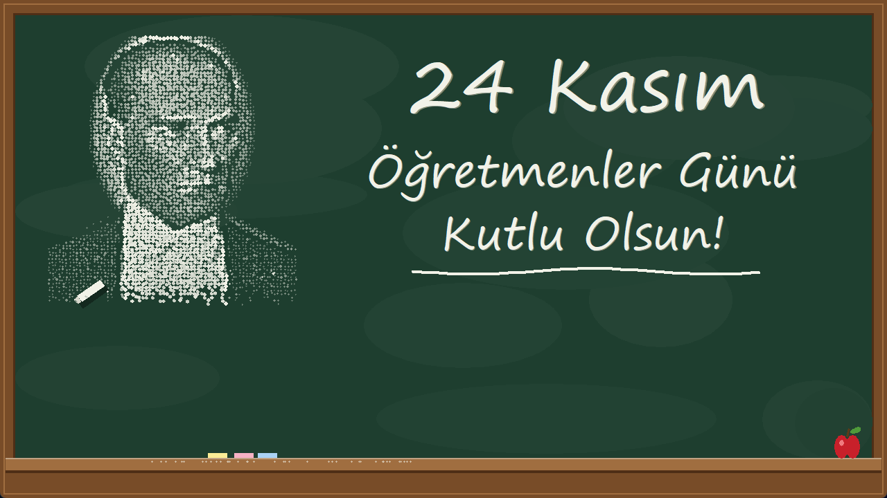
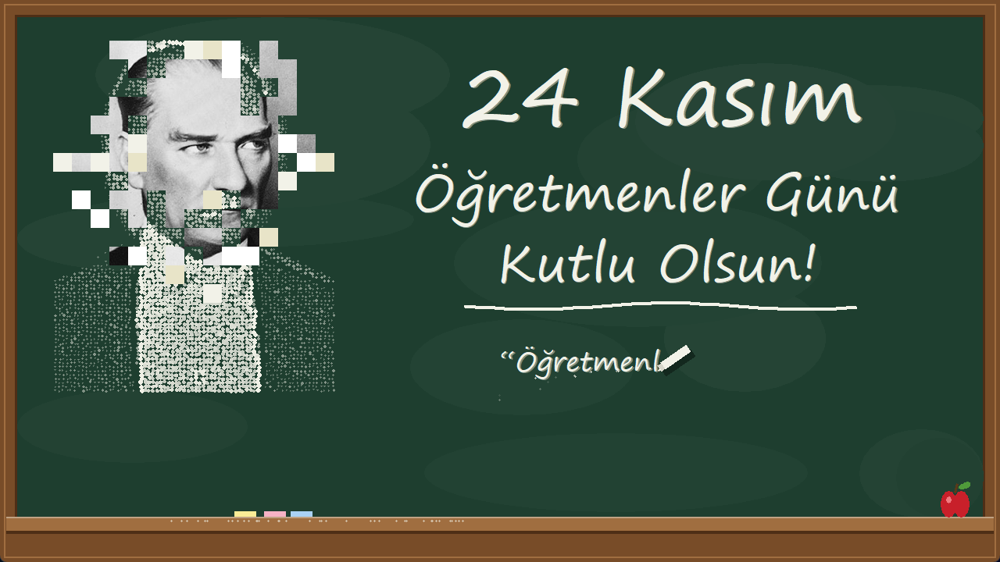

# 24 Kasım Öğretmenler Günü 🍎

Python ile yapılmış animasyonlu bir kara tahta: Öğretmenler Günü tebrik ekranı. Sadece Python'un standart kütüphanesi (`tkinter`) kullanılır, **hiçbir paket kurmanız gerekmez**.



## Neler var?

- **Takvim yaprağı:** Tahtaya çivili bir duvar takvimi iner, üzerinde "23 Kasım Pazartesi" yazar. Yaprak alttan kıvrılarak koparılır ve dönerek düşer, altından kırmızı **24 Kasım Salı – Öğretmenler Günü** çıkar. Ardından takvim tahtadan kaldırılır.
- **Tebeşirle yazı:** Tebeşir tahtada gezinip "24 Kasım Öğretmenler Günü Kutlu Olsun!" yazısını harf harf yazar, yazarken toz döker.
- **Tebeşir tozundan Başöğretmen portresi:** Tebeşir gidip gelerek Atatürk portresini tozdan noktalarla gölgelendirir. Aydınlık yerlerde noktalar iri ve parlak, karanlık yerlerde ince olur.
- **Tozdan fotoğrafa geçiş:** Toz, yüzün ortasından başlayıp dışa doğru kare kare kaybolur. Altından gerçek fotoğraf çıkar ve bantla tahtaya yapıştırılmış bir kâğıda döner.
- **Atatürk'ün sözü:** "Öğretmenler! Yeni nesil sizin eseriniz olacaktır."
- **Final:** Renkli tebeşirle yıldızlar ve kalpler çizilir. Sıralardan kâğıt uçaklar fırlatılır, arkalarında tebeşir tozundan iz bırakırlar.

| Takvim yaprağı | Tebeşir tozundan portre | Tozdan fotoğrafa | Son hâl |
|---|---|---|---|
|  |  |  |  |

## Çalıştırma

Python 3 kurulu olması yeterli:

```bash
python ogretmenler.py
```

| Tuş | İşlev |
|---|---|
| `Boşluk` | Durdur / devam |
| `Esc` | Çıkış |

## Ayarlar

`ogretmenler.py` içinde:

- `Calendar.DROP`, `PEEL`, `LIFT`: takvimin inme, yaprağın kopma ve takvimin kaldırılma zamanları
- `TITLE_START`, `QUOTE_START`: başlığın ve sözün yazılmaya başlama anı
- `PORTRAIT_START`, `PORTRAIT_SCAN`: portrenin tebeşirle çizilmeye başlama anı ve süresi
- `MORPH`, `MORPH_LEN`: tozun kaybolup fotoğrafın çıkma anı ve süresi
- `PLANES_START`: kâğıt uçakların uçmaya başlama anı
- `BOARD`, `CHALK`: tahta ve tebeşir renkleri

El yazısı için Windows'taki `Segoe Print` yazı tipi kullanılır. Bu yazı tipi yoksa sırasıyla `Ink Free` ve `Comic Sans MS` denenir.

> Not: Portredeki baş/omuz maskesi (`ChalkPortrait.HEAD`, `BODY_TOP`, `NECK`) bu depodaki `ataturk.png` için ayarlıdır. `ataturk.png` yoksa ekran portresiz açılır ve yazılar ortalanır.

## Fotoğraf

Atatürk fotoğrafı Wikimedia Commons'taki [Ataturk1930s.jpg](https://commons.wikimedia.org/wiki/File:Ataturk1930s.jpg) dosyasından alınmıştır (kamu malı / public domain). Baş ve yaka kısmı kırpılıp yeniden boyutlandırılmıştır.

---

**Tüm öğretmenlerimizin Öğretmenler Günü kutlu olsun!** 🍎 24 Kasım 2026
